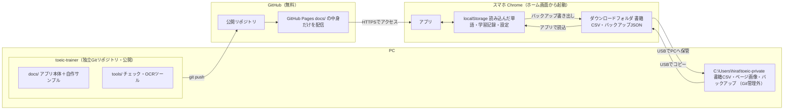
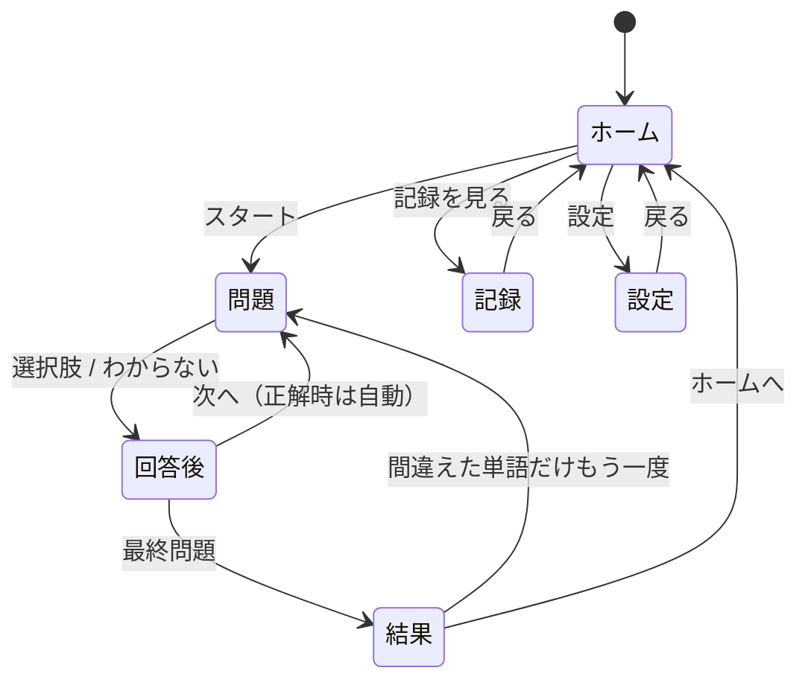
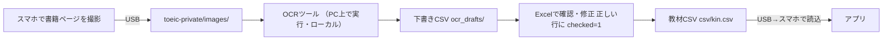

# 設計書：自分専用 TOEIC 単語学習アプリ（TOEIC Trainer）

| 項目 | 内容 |
| :--- | :--- |
| 版 | v4（2026-10-22） |
| 置き場所 | `c:\Users\hirat\AI-Brain\toeic-trainer\`（**AI-Brain とは別の独立した Git リポジトリ**として管理。§10） |
| 書籍データの置き場所 | `C:\Users\hirat\toeic-private\`（**プロジェクトの外**。Git 管理外・OneDrive 同期外。§11） |
| 使う端末 | Android スマホの Chrome（PC は開発とデータ作成のみ） |
| 技術 | HTML / CSS / JavaScript のみ（ライブラリ・ビルド・サーバー処理なし）。OCR ツールのみ PC 上の Python |
| 費用 | 0円 |

### v3 → v4 の変更点
| 変更 | 該当箇所 |
| :--- | :--- |
| 独立した Git リポジトリとして管理する構成と手順を追加 | §10 |
| 書籍データをプロジェクトの外に置き、配信フォルダを `docs/` に限定。公開前後のチェック手順を追加 | §2, §11, §12 |
| 学習記録のバックアップを「記録」と同じフェーズ4で実装。記録が消える原因と対策を整理 | §7, §14 |
| OCR 取り込みを正式なフェーズ6として追加 | §13, §14 |
| CSV 読み込みに `checked` 列（確認済みの行だけ取り込む）と文字コード対応を追加 | §6.2 |

---

## 1. 目的と方針

### 1.1 目的
手持ちの『金のフレーズ』などを使い、**「ランダム4択 → 即判定 → 発音 → 記録」がテンポよく回る単語アプリ**をスマホで毎日使えるようにする。あわせて、書籍の単語を手入力する負担を OCR（画像からの文字読み取り）で減らす。目的は TOEIC のスコアアップなので、「作り込み」より「毎日使えて覚えられること」を優先する。

### 1.2 設計方針
1. **テンポ最優先**：1問あたり数秒で回せる操作にする（正解したら自動で次へ進む）。
2. **記憶に効く仕組みを最小限で入れる**：間違えた単語・自信がない単語がまた出てくるようにする。
3. **シンプルな作り**：ファイル数は最小限。データは CSV、保存はブラウザの `localStorage` だけ。
4. **書籍データは配信しない**：Web に置くのはアプリ本体と自作サンプルだけ。書籍の単語はスマホ上で CSV ファイルを読み込む。
5. **学習記録は自分でバックアップできる**：ブラウザのデータが消えても、書き出したファイルから戻せるようにする。

---

## 2. 全体構成



**ポイント**
- GitHub に上がるのは `toeic-trainer` フォルダの中身だけ。書籍データはこのフォルダの外にあるため、**操作ミスがあってもGitに入る経路がない**。
- Web サイトとして配信されるのは `docs/` の中身だけ（設計書やツールは配信されない）。
- スマホで読み込んだ書籍データはスマホの中（`localStorage`）にだけ保存される。アプリはサーバーへデータを送る処理を一切持たない（§8）。

---

## 3. 学習の流れと画面

### 3.1 画面の移り変わり



※ 試作品（フェーズ2）はホーム・問題・結果の3画面。「記録」「設定（バックアップ）」はフェーズ4、「設定（CSV読み込み）」はフェーズ5で追加。

### 3.2 各画面の内容

#### ① ホーム
| 要素 | 内容 |
| :--- | :--- |
| 今日のサマリー | 今日の回答数・正答率・連続学習日数（フェーズ4〜） |
| バックアップ通知 | 最後のバックアップから7日以上たっていれば表示（フェーズ4〜。§7.4） |
| 教材の選択 | 「サンプル」「金フレ」など読み込んだ教材から選ぶ（フェーズ5〜。それまではサンプル固定） |
| 出題モード | **おまかせ**（苦手・未学習を優先して混ぜる）／**ランダム**／**苦手だけ**（フェーズ4〜。試作品はランダムのみ） |
| 出題数 | 10 / 20 / 30 から選ぶ（初期値10） |
| スタートボタン | 画面下部に大きく配置 |

#### ② 問題
```
┌──────────────────────────┐
│ ✕          3 / 10        │ ← 中断ボタン・進捗
│ ▓▓▓▓▓░░░░░░░░░░░░░░░    │ ← 進捗バー
│                          │
│        confirm   🔊      │ ← 英単語（大）＋発音ボタン
│        [動詞]            │ ← 品詞（データにあれば）
│                          │
│ ┌──────────────────────┐ │
│ │ 〜を確認する          │ │
│ └──────────────────────┘ │
│ ┌──────────────────────┐ │ ← 4択（縦並び・親指で押せる位置）
│ │ 〜を延期する          │ │
│ └──────────────────────┘ │
│ ┌──────────────────────┐ │
│ │ 〜を交換する          │ │
│ └──────────────────────┘ │
│ ┌──────────────────────┐ │
│ │ 〜を提出する          │ │
│ └──────────────────────┘ │
│        わからない         │ ← 当てずっぽうを防ぐ（不正解扱い）
└──────────────────────────┘
```
- 問題が表示されたら英単語を自動で読み上げる（設定で OFF 可、フェーズ5）。
- 🔊を押せば何度でも聞き直せる。

#### ③ 回答後（問題画面の上に結果を重ねて表示）
| 回答 | 表示 | 次への進み方 |
| :--- | :--- | :--- |
| 正解 | 押したボタンが緑＋「⭕」。フレーズ／例文があれば表示 | **約0.9秒後に自動で次へ**（「次へ」ボタンは出さない） |
| 不正解 | 押したボタンが赤、正解が緑＋「❌」。正しい意味・フレーズ／例文を表示 | **約1.8秒後に自動で次へ**（「次へ」ボタンは出さず、テンポよく完全自動で進行） |
| わからない | 正解を緑で表示（不正解として記録） | **約1.8秒後に自動で次へ** |

- 回答後はフレーズ／例文の🔊も押せる（データにあれば）。
- 回答後は選択肢を押せなくする（連打による二重記録を防ぐ）。

#### ④ 結果
- 正答数 / 出題数、正答率（%）
- 間違えた単語の一覧（英単語・意味・🔊）
- ボタン：「間違えた単語だけもう一度」（間違いが0なら非表示）、「もう一度」、「ホームへ」

#### ⑤ 記録（フェーズ4）
- 連続学習日数、累計回答数、全体の正答率
- **直近14日の棒グラフ**（1日あたりの回答数。CSS だけで描く）
- 習熟度の内訳：未学習 / 苦手 / 学習中 / 覚えた の語数
- 苦手単語の一覧（不正解が多い順）

#### ⑥ 設定
| 項目 | 追加時期 |
| :--- | :--- |
| 学習記録の書き出し（バックアップ）・読み込み（復元）、最終バックアップ日、データ保護の状態 | フェーズ4 |
| 教材 CSV の読み込み・教材の削除 | フェーズ5 |
| 自動読み上げ ON/OFF、読み上げ速度（0.8 / 1.0） | フェーズ5 |

---

## 4. 出題ロジック

### 4.1 試作品（フェーズ2）：ランダム出題
1. 教材の全単語をシャッフルする（偏りのない並べ替え方法：Fisher–Yates 法）。
2. 先頭から出題数ぶんを取り出す → **1回の学習内で同じ単語は出ない**。
3. 教材の語数が出題数より少なければ、全語を出題する。

### 4.2 誤答（ハズレの選択肢）の作り方
1. 候補 ＝ 出題語以外の単語のうち、**正解と意味の文字列が同じものを除いたもの**。
2. 候補のうち**同じ品詞の単語を優先**して3つ選ぶ（品詞だけで答えが分かるのを防ぐ）。足りなければ他の品詞から補う。
3. 選んだ3つの意味が互いに重複しないようにする。
4. 正解と合わせた4つをシャッフルして表示する。
5. 教材が4語未満なら「単語が4語以上必要です」と表示して開始しない。

### 4.3 習熟度（フェーズ4）
単語ごとに記録する「連続正解数」で判定する。

| 習熟度 | 条件 |
| :--- | :--- |
| 未学習 | 一度も出題されていない |
| 苦手 | 直近の回答が不正解（連続正解数 0） |
| 学習中 | 連続正解数 1〜2 |
| 覚えた | 連続正解数 3以上 |

- 正解 → 連続正解数 +1。不正解・わからない → 0 に戻す。

### 4.4 「おまかせ」モード（フェーズ4）
出題数 N のうち、次の順で枠を埋める（足りない枠は次の区分から補う）。
1. **苦手**：最大 N の 40%（古く間違えた順）
2. **未学習**：最大 N の 40%（教材の並び順＝本の番号順。本と進度をそろえるため）
3. **学習中**：残り（最後に回答した日が古い順）
4. それでも足りなければ **覚えた** から（古い順）

選んだ N 語は最後にシャッフルして出題する。

---

## 5. 音声

- ブラウザ内蔵の音声合成（Web Speech API の `speechSynthesis`）を使い、英語（`en-US`）で読み上げる。
- 読み上げ対象：英単語（問題表示時・🔊）、フレーズ／例文（回答後の🔊）。
- 読み上げ中に次の読み上げが来たら、前の読み上げを止めてから読む（音が重ならないように）。
- 音声機能がない環境では🔊を非表示にし、学習はそのまま続けられるようにする。

---

## 6. データ設計

### 6.1 単語 CSV の形式
```csv
id,word,meaning,pos,phrase,phrase_ja
kin-0001,confirm,〜を確認する,動詞,confirm the reservation,予約を確認する
```

| 列 | 必須 | 内容 |
| :--- | :---: | :--- |
| `id` | ○ | `教材略称-番号`（例：`kin-0001`）。**番号は本の見出し語番号に合わせる**と、本との対応が分かりやすい。学習記録はこの `id` に紐づくので、**一度決めたら変えない** |
| `word` | ○ | 英単語 |
| `meaning` | ○ | 日本語の意味（選択肢に表示される。短く1つに絞ると4択が解きやすい） |
| `pos` | | 品詞（動詞 / 名詞 / 形容詞 / 副詞 / その他）。誤答選びに使う |
| `phrase` | | フレーズや例文（金フレの「フレーズ」を想定） |
| `phrase_ja` | | フレーズの訳 |
| `checked` | | `1` の行だけ取り込む（OCR の下書きで使う。§13）。列がなければ全行を取り込む |

- 1行目は見出し行。上の表にない列は無視する（OCR 用のメモ列などがあっても読み込める）。
- 意味の中にカンマ（`,`）を含む場合は `"〜を確認する, 裏付ける"` のようにダブルクォートで囲む（Excel で保存すれば自動でそうなる）。意味の区切りには読点「、」を使うのがおすすめ。

### 6.2 CSV 読み込みのルール（フェーズ5）
| 状況 | 動き |
| :--- | :--- |
| 文字コード | UTF-8（BOM付き・なし）を読む。UTF-8 として読めなければ Shift_JIS として読む（Excel の「CSV（コンマ区切り）」保存は Shift_JIS になるため） |
| 必須列が空の行 | その行を飛ばし、「◯行目：意味が空です」のように一覧で表示 |
| `checked` 列があり、値が `1` でない行 | 取り込まない（件数を表示） |
| 同じ `id` がファイル内に2回ある | 後の行を飛ばして警告 |
| 同じ教材を再度読み込んだ | 教材の単語を新しい内容で置き換える（**学習記録は `id` が同じなら引き継ぐ**） |
| 読み込み前 | 「◯語を読み込みます（スキップ◯件）」と確認してから保存 |

→ 誤字に気づいたら PC で CSV を直し、もう一度読み込むだけで修正できる。

### 6.3 自作サンプル
- `docs/data/sample_words.js` に30語を JavaScript の配列で書く（CSV と同じ項目）。
- TOEIC 頻出の基本語を選び、意味・フレーズはすべて自作する（書籍の文章は写さない）。
- `id` は `sample-001` 〜 `sample-030`。

### 6.4 localStorage に保存する内容
キーには必ず `toeic.` を付ける（理由は §7.2 の「同じ住所を共有する」問題）。

| キー | 中身 | 追加時期 |
| :--- | :--- | :--- |
| `toeic.progress` | 単語ごとの記録・日ごとの記録 | フェーズ4 |
| `toeic.progress.prev` | 復元・形式変更の直前の記録（1世代だけ） | フェーズ4 |
| `toeic.meta` | 最終バックアップ日時など | フェーズ4 |
| `toeic.decks` | 読み込んだ教材の単語 | フェーズ5 |
| `toeic.settings` | 自動読み上げ・速度・前回の出題数など | フェーズ5 |

```json
// toeic.progress の例
{
  "schemaVersion": 1,
  "words": {
    "kin-0001": { "correct": 5, "wrong": 2, "streak": 3, "lastAt": "2026-10-22" }
  },
  "days": {
    "2026-10-22": { "answered": 30, "correct": 24 }
  }
}
```
- 日付は**スマホの現地時刻**で `YYYY-MM-DD`。
- **連続学習日数**は `days` から計算する（今日か昨日に記録があれば、そこから1日ずつさかのぼって数える）。値としては保存しない（ずれを防ぐため）。
- 記録は**1問答えるごとに保存**する（途中でアプリを閉じても、そこまでの記録が残る）。
- 容量の見積もり：単語ごとの記録 約60バイト × 2,000語 ≒ 120KB、日ごとの記録 約50バイト × 3年分 ≒ 55KB。localStorage の上限（数MB）に対して十分小さい。

---

## 7. 学習記録の保全とバックアップ（フェーズ4）

### 7.1 方針
1. **「記録の保存」と「バックアップの書き出し・復元」は同じフェーズ4で作り、バックアップが動くことを確認してから本格的に記録を貯め始める。** フェーズ2〜3では記録を保存しないため、バックアップがない状態で記録が貯まる期間は発生しない。
2. **最も重要で確実な保護手段は「JSON形式でのバックアップ書き出し・復元」である。** Chromeのホーム画面に追加することや、ブラウザのデータ保護機能（`navigator.storage.persist()`）はあくまで補助的な対策であり、それだけで学習記録の消失を完全に防げるわけではない。

### 7.2 記録が消える原因と対策
| 原因 | 起こりやすさ | 対策 |
| :--- | :--- | :--- |
| Chrome の「閲覧履歴データの削除」でサイトデータを消す | 中（うっかり） | **手動バックアップから復元**（ブラウザの保護機能では防げない） |
| スマホの機種変更・初期化・Chrome の再インストール | 確実に起きる（数年に1回） | **PC に保管したバックアップから復元** |
| スマホの空き容量不足で、ブラウザがデータを自動削除 | 低 | **手動バックアップ** ＋ 補助として「データ保護」を要求（下記） |
| **アプリの住所（URL のドメイン部分）が変わる** | 配信先を変えたときに確実に起きる | 下記の注意を参照。旧URLで書き出し→新URLで復元 |
| アプリの不具合で記録が壊れる | 低 | 形式チェック、直前の記録を1世代保持（`toeic.progress.prev`）、**手動バックアップ** |

- **データ保護（`navigator.storage.persist()`）の限界と実行結果の確認設計**：
  - 起動時に `navigator.storage.persisted()` で現在の状態を確認し、未許可であれば `navigator.storage.persist()` を呼び出してその戻り値（`true`：許可 / `false`：拒否）およびAPI非対応の有無を取得する。
  - **呼び出しただけで必ず許可されるわけではない**（Chromeが利用頻度やインストール状態をもとに内部判定するため、拒否されることもある）。また、仮に許可されても防げるのは「端末の容量不足によるブラウザの自動削除」だけであり、操作ミスによる履歴削除や端末故障からは一切守られない。
  - そのため、実行結果を `toeic.meta` に記録し、設定画面に**「ブラウザの自動削除保護：許可済み / 未許可（要バックアップ） / 非対応」**と明確に表示する。未許可の場合でも学習機能は通常通り動作させ、定期的なJSONバックアップを促す設計とする。
- **住所の注意**：`localStorage` はドメイン（`https://ユーザー名.github.io` の部分）ごとに分かれている。
  - GitHub Pages では、同じユーザーの他のサイトとこの住所を共有するため、キー名に `toeic.` を付けて混ざらないようにする。
  - GitHub のユーザー名変更や配信先の変更（Cloudflare Pages への移行など）をすると住所が変わり、**記録が見えなくなる**（消えてはいないが新しい住所からは読めない）。移行前に必ずバックアップを書き出す。

### 7.3 バックアップファイル
- ファイル名：`toeic-backup-20261022-2130.json`（日時付き。上書きされないように）
- 保存先：スマホの「ダウンロード」フォルダ（Chrome の通常のダウンロード）
- 中身：

```json
{
  "app": "toeic-trainer",
  "type": "backup",
  "schemaVersion": 1,
  "exportedAt": "2026-10-22T21:30:00+09:00",
  "progress": { "...": "toeic.progress の中身" },
  "settings": { "...": "toeic.settings の中身（あれば）" }
}
```
- **書籍の単語（`toeic.decks`）は含めない**。書籍データの元は PC の CSV にあり、読み込み直せば戻る。バックアップファイルに書籍データを入れないことで、バックアップをどこに保管しても書籍データが広がらない。

### 7.4 書き出し・復元・通知の動き
| 操作 | 動き |
| :--- | :--- |
| 書き出し | 設定画面のボタン1つで JSON をダウンロード。`toeic.meta` に最終バックアップ日時を記録 |
| 復元 | ファイルを選ぶ →（1）`app`・`type`・`schemaVersion`・中身の形をチェック →（2）「記録◯日分・単語◯語・最終学習日◯月◯日」と内容を表示 →（3）確認後、今の記録を `toeic.progress.prev` に退避してから**置き換える**（足し合わせはしない。仕組みを単純にするため） |
| 復元の取り消し | 復元直後に限り「元に戻す」で `toeic.progress.prev` から戻せる |
| 通知 | 最後のバックアップから7日以上たち、その間に学習していればホームに「バックアップしましょう」と表示 |
| 保存失敗 | 書き込みに失敗したら（容量不足など）画面に表示する。黙って失敗しない |

### 7.5 運用ルール（推奨）
- 週に1回、設定画面から書き出す。
- 月に1回程度、スマホのダウンロードフォルダのバックアップを USB で `C:\Users\hirat\toeic-private\backups\` にコピーする（スマホ自体の故障・紛失に備える）。

---

## 8. プログラムの構成（app.js の中身）

1ファイルの中を、役割ごとのまとまりに分けて書く。

| まとまり | 役割 | 主な処理 | 時期 |
| :--- | :--- | :--- | :--- |
| データ | 教材の単語を用意する | サンプルと読み込み済み教材をまとめて返す | 2 |
| 出題 | 問題を作る | シャッフル、出題語の選択、誤答の選択 | 2 |
| 学習中の状態 | 今の学習の進み具合を持つ | 何問目か、正解数、間違えた単語 | 2 |
| 画面 | 表示を切り替える | 各画面の表示、ボタンの色変更 | 2 |
| 音声 | 読み上げる | 英単語・フレーズの読み上げ、止める | 2 |
| 保存 | localStorage の読み書き | 読み込み時の形式チェック、書き込み失敗の検知、形式の版管理 | 4 |
| 記録 | 集計する | 1問ごとの保存、習熟度、連続日数・正答率の計算 | 4 |
| バックアップ | 書き出し・復元 | JSON の作成・ダウンロード、ファイルのチェック・復元 | 4 |
| CSV 読み込み | 教材を取り込む | 文字コード判定、CSV の分解、チェック、保存 | 5 |

**守るルール**
- 画面は `index.html` の中に区画を用意し、表示する区画だけ切り替える（ページは移動しない）。
- CSV などの中身は必ず「文字」として画面に入れる（HTML として扱わない）。
- **外部との通信処理（`fetch` など）を書かない**。アプリが読み込むのは自分の `docs/` 内のファイルだけ。これにより「書籍データや記録がどこにも送信されない」ことをコードを見て確認できる。

---

## 9. 画面デザインの決まりごと

- スマホの縦画面専用。幅360〜430px で崩れないようにする。PC で開いた場合は中央に幅430px で表示。
- 選択肢ボタンは高さ56px 以上、文字16px 以上。英単語は32px 以上。
- 主要なボタンは画面の下半分に置く（片手の親指で届くように）。
- 色：正解＝緑、不正解＝赤、通常＝白地にグレーの枠。色だけでなく⭕❌の記号でも区別する。
- 画面の拡大縮小（ピンチ操作）は無効にしない。

---

## 10. プロジェクトと Git の管理

### 10.1 現状（2026-10-22 確認）
| 項目 | 状態 |
| :--- | :--- |
| `AI-Brain` | Git リポジトリ。**リモート（GitHub 等の接続先）は未設定**。未コミットの変更・未追跡ファイルが多数ある（今回は触らない） |
| `AI-Brain/.gitignore` | `toeic-trainer/` を追記済み。**ただしこの変更自体はまだ AI-Brain 側でコミットされていない** |
| `toeic-trainer/` | 中身は `DESIGN.md` のみ。AI-Brain の Git からは無視されている（`git check-ignore` で確認済み）。AI-Brain の Git に記録されたファイルはない |
| `toeic-trainer/.git` | まだない（独立リポジトリは未作成） |
| ツール | Git 2.55 あり（Windows 版 Git には GitHub ログイン用の Git Credential Manager が付属）。GitHub CLI（`gh`）はなし |

### 10.2 構成：AI-Brain の中に「独立したリポジトリ」を置く

```text
AI-Brain/                  ← AI-Brain のリポジトリ（GitHubには接続しない）
├── .gitignore             ← toeic-trainer/ を無視
└── toeic-trainer/         ← TOEIC Trainer 専用のリポジトリ（.git を持つ）→ GitHub に公開
```

- AI-Brain の `.gitignore` で `toeic-trainer/` を無視しているため、AI-Brain の Git は TOEIC Trainer のファイルを一切扱わない。
- `toeic-trainer/` 内に独自の `.git` を作ると、そのフォルダ内で実行した Git 操作は TOEIC Trainer のリポジトリに対して行われる。
- サブモジュール（リポジトリの中に別のリポジトリを登録する Git の機能）は**使わない**。両者を関連づける必要がなく、仕組みが複雑になるため。
- フォルダの移動は不要。将来 AI-Brain の外に移したくなっても、フォルダごと移動するだけで履歴ごと移せる。

### 10.3 注意点
1. **`toeic-trainer/.git` を作る前**は、`toeic-trainer` の中で Git コマンドを打つと**親の AI-Brain リポジトリが操作される**。作成後も、操作前に次のコマンドで対象を確認する。
   ```powershell
   git rev-parse --show-toplevel   # → C:/Users/hirat/AI-Brain/toeic-trainer と表示されればOK
   ```
2. `AI-Brain/.gitignore` の `toeic-trainer/` 追記は、AI-Brain 側でコミットしておくのが望ましい。この行が消えると、AI-Brain で `git add .` をしたときに TOEIC Trainer が「埋め込みリポジトリ」として誤って登録される。**AI-Brain 側のコミットは平田さんの判断で行う**（AI-Brain には他の未コミット変更もあるため、こちらでは操作しない）。

### 10.4 作成手順（実施時期）
| 手順 | 時期 | 内容 |
| :--- | :--- | :--- |
| ① ローカルリポジトリ作成 | フェーズ2の開始時 | `toeic-trainer` で `git init`、`.gitignore` と誤コミット防止フックを設置（§11.3）、最初のコミット |
| ② GitHub リポジトリ作成 | フェーズ3 | GitHub の Web 画面で空の公開リポジトリ `toeic-trainer` を作成（README 等は付けない） |
| ③ 公開前チェック | フェーズ3 | §11.4 のチェックを実行 |
| ④ 接続・送信 | フェーズ3 | `git remote add origin ...` → `git push`。ログインはブラウザで行う（Git Credential Manager）。**パスワードやトークンをファイルに書かない** |
| ⑤ Pages 設定 | フェーズ3 | リポジトリの Settings → Pages で「main ブランチの `/docs` フォルダ」を配信元に指定 |
| ⑥ 公開後チェック | フェーズ3 | §11.5 のチェックを実行 |

---

## 11. 書籍データの公開防止

### 11.1 何が公開されるのか
| 対象 | 公開範囲 |
| :--- | :--- |
| GitHub リポジトリ（無料プランでは公開が必須） | **コミットされた全ファイルと、その全履歴**が誰でも見られる |
| GitHub Pages の Web サイト | URL を知っていれば誰でも開ける。検索エンジンに載る可能性もある。パスワードはかけられない |
| スマホの localStorage | スマホの中だけ。アプリは送信処理を持たないため、どこにも送られない |

→ **「Web サイトとリポジトリは公開されるもの」として扱い、書籍データはそもそもそこに入れない**。
- Web サイトには検索エンジン避けの指定（`<meta name="robots" content="noindex">`）を入れる。ただしこれは「検索に載りにくくする」だけで、アクセスを防ぐものではない。

### 11.2 4重の防止策
| 層 | 対策 | 防げること |
| :--- | :--- | :--- |
| 1. 置き場所 | 書籍データ（ページ画像・CSV・OCR下書き）は**リポジトリの外の `C:\Users\hirat\toeic-private\` に置く** | Git の対象フォルダに存在しないので、コミットされる経路がない |
| 2. `.gitignore` | 万一フォルダ内に置いても無視されるよう、CSV・画像・PDF・バックアップを登録 | うっかりコピーしてしまった場合 |
| 3. コミット前フック | コミットしようとしたファイルに CSV・画像（アイコン以外）・PDF・バックアップが含まれていたら**コミットを止める**スクリプト | `.gitignore` を書き換えた／強制追加した場合 |
| 4. 公開前・公開後チェック | §11.4・§11.5 の手順で、Git が追跡しているファイルと配信されているファイルを目で確認 | 上記すべてをすり抜けた場合 |

- `toeic-private` を `Documents` の下にしない理由：`Documents` は OneDrive と同期されている場合があり、意図せずクラウドに上がる可能性があるため。

**`.gitignore` の内容（予定）**
```gitignore
# 書籍データ・個人データ（念のため。本来はリポジトリの外に置く）
private/
*.csv
*.jpg
*.jpeg
*.heic
*.pdf
*.png
!docs/icons/*.png
toeic-backup-*.json

# Python
__pycache__/
.venv/
```

### 11.3 コミット前フック
- `tools/git-hooks/pre-commit` にスクリプトを置き、`git config core.hooksPath tools/git-hooks` で有効にする（手順①で実施）。
- コミット対象に次のファイルがあれば、理由を表示してコミットを中止する：`.csv`、`.jpg/.jpeg/.png/.heic`（`docs/icons/` 以外）、`.pdf`、`toeic-backup-*.json`、`private/` 以下。

### 11.4 公開前チェック（push の前に毎回）
`tools/check_publish.ps1` にまとめ、1コマンドで実行できるようにする。中身は次のとおり。

| # | 確認内容 | コマンド | 合格条件 |
| :--- | :--- | :--- | :--- |
| 1 | 操作対象のリポジトリ | `git rev-parse --show-toplevel` | `.../AI-Brain/toeic-trainer` |
| 2 | 追跡中の全ファイル一覧 | `git ls-files` | 一覧を目で確認。§12 のファイル以外がない |
| 3 | 危険な拡張子が追跡されていないか | `git ls-files` を CSV・画像・PDF で絞り込み | `docs/icons/` のアイコン以外に何も出ない |
| 4 | 過去の履歴にも含まれていないか | `git log --all --name-only --format=""` を同様に絞り込み | 同上 |
| 5 | 書籍データの置き場所を無視しているか | `git check-ignore -v private/test.csv` | `.gitignore` の行が表示される |
| 6 | 未コミットの変更がないか | `git status` | 意図した状態であること |

### 11.5 公開後チェック（初回公開時・構成を変えたとき）
| # | 確認内容 | 合格条件 |
| :--- | :--- | :--- |
| 1 | GitHub のリポジトリ画面でファイル一覧を見る | 書籍データがない |
| 2 | `https://ユーザー名.github.io/toeic-trainer/` を開く | アプリが動く |
| 3 | `https://ユーザー名.github.io/toeic-trainer/DESIGN.md` を開く | 404（`docs/` 以外は配信されていない） |
| 4 | アプリでサンプル単語だけが出ることを確認 | 書籍の単語が出ない（スマホで読み込むまでは） |

### 11.6 万一、書籍データを公開してしまったら
1. すぐにリポジトリを非公開にするか削除する（GitHub の Settings）。
2. **新しいコミットでファイルを削除するだけでは不十分**（過去の履歴に残り、誰でも見られる）。履歴から消す作業か、リポジトリの作り直しが必要。
3. このため、防止策（§11.2）を重ねて「そもそも入らない」ようにしている。

### 11.7 著作権について
- 購入した本を自分で撮影・入力して個人の学習に使うことは、私的使用のための複製の範囲と考えている（法的な助言ではない）。
- サンプル単語の意味・フレーズは自作し、書籍の文章をアプリ本体に入れない。
- 書籍データを外部サービス（クラウド OCR・翻訳 API など）に送らない。スマホへの転送は USB ケーブルを既定とし、Google ドライブ等を使うかは本人が判断する。

---

## 12. ファイル構成

```text
toeic-trainer/                  ← 独立した Git リポジトリ（GitHub で公開）
├── .gitignore                  # §11.2
├── DESIGN.md                   # この設計書（リポジトリには入るが、Webサイトでは配信されない）
├── README.md                   # 使い方・更新手順・公開前チェックの手順（フェーズ3）
├── docs/                       # ★GitHub Pages で配信されるのはこのフォルダだけ
│   ├── .nojekyll               # GitHub の自動変換機能を止める空ファイル（フェーズ3）
│   ├── index.html              # 画面の骨組み
│   ├── style.css               # 見た目
│   ├── app.js                  # 動き（§8）
│   ├── manifest.json           # ホーム画面に追加したときの名前・アイコン（フェーズ3）
│   ├── icons/
│   │   ├── icon-192.png        # アプリアイコン（フェーズ3）
│   │   └── icon-512.png
│   └── data/
│       └── sample_words.js     # 自作サンプル30語
└── tools/                      # PC 用のツール（配信されない）
    ├── git-hooks/
    │   └── pre-commit          # 書籍データの誤コミット防止（§11.3）
    ├── check_publish.ps1       # 公開前チェック（§11.4、フェーズ3）
    └── ocr/                    # OCR 取り込みツール（フェーズ6）

C:\Users\hirat\toeic-private\   ← 書籍データ（Git 管理外・OneDrive 外）※フェーズ5で作成
├── csv\                        # 完成した教材 CSV（例：kin.csv）
├── images\                     # 書籍ページの写真（フェーズ6）
├── ocr_drafts\                 # OCR の下書き CSV（フェーズ6）
└── backups\                    # スマホから持ってきた学習記録バックアップ
```

> `docs/` という名前は GitHub Pages の決まり（配信元に指定できるフォルダ名が `/`（全体）か `/docs` のどちらか）によるもの。中身は「ドキュメント」ではなく「アプリ本体」。

---

## 13. OCR による書籍データの取り込み（フェーズ6）

### 13.1 位置づけ
- 目的：書籍の単語を手入力する負担を減らす。
- **CSV 読み込み（フェーズ5）が完成し、手入力の CSV でアプリが使えることを確認してから着手する**。OCR の出力先は「フェーズ5で読み込める CSV」なので、先に受け皿を完成させておく。
- OCR は誤認識や「単語と意味の対応ずれ」が必ず起きる前提で、**OCR は下書きを作るだけ、人が確認した行だけを取り込む**流れにする。

### 13.2 全体の流れ



### 13.3 OCR エンジンの候補（すべて無料・PC内で処理）
| 候補 | 特徴 | 懸念 |
| :--- | :--- | :--- |
| **Windows 標準の OCR**（Windows.Media.Ocr） | Windows 11 に内蔵。追加ソフト不要（日本語の言語パックは必要） | Python から呼ぶための追加パッケージが必要 |
| **Tesseract** | 定番の無料 OCR。英語の精度は高い | 本体のインストールと日本語データの追加が必要。日本語の精度は写真の質に左右される |

- 重い AI 系 OCR（PaddleOCR、EasyOCR など）は導入が大きく複雑なため、上の2つで不十分な場合のみ検討する。
- クラウド OCR（Google レンズ、Cloud Vision など）は書籍データを外部に送ることになるため使わない。

### 13.4 進め方
| 段階 | 内容 | 判断基準 |
| :--- | :--- | :--- |
| 6-1 撮影ルールを決める | 真上から・明るく・1ページ1枚・影を入れない。ファイル名にページ番号（例：`kin_p012.jpg`） | — |
| 6-2 少数ページで試す | **3〜5ページ**で、2つの OCR エンジンを比較。英単語・意味それぞれの正しく読めた割合と、1ページの修正にかかった時間を記録 | — |
| 6-3 採用判断 | 修正時間と手入力時間を比べる | 下の表 |
| 6-4 ツール作成 | 画像フォルダ → 下書き CSV を出力する Python スクリプト（`tools/ocr/`） | 試したページで下書きが出る |
| 6-5 1ユニットで本番試行 | 1ユニット分を「撮影→OCR→確認→読み込み→学習」まで通す | スマホで出題できる |
| 6-6 残りを処理 | 1ユニットずつ進める（一度に大量に処理しない） | — |

**6-3 の判断基準**
| 結果 | 方針 |
| :--- | :--- |
| 修正時間が手入力の半分以下 | 英単語・意味ともに OCR を使う |
| 英単語は読めるが日本語の誤りが多い | **英単語と番号だけ OCR**し、意味は手入力（英語の OCR は日本語より精度が高いため、現実的な落としどころ） |
| どちらも誤りが多い | OCR をやめて手入力にする（無理に作り込まない） |

### 13.5 下書き CSV の形式
§6.1 の列に、確認用の列を加える。アプリは `checked` 以外の追加列を無視するので、確認後そのまま読み込める。

```csv
id,word,meaning,pos,phrase,phrase_ja,checked,source,raw_text
kin-0012,postpone,〜を延期する,動詞,postpone the meeting,会議を延期する,,kin_p012.jpg,"12 postpone ..."
```
| 追加列 | 内容 |
| :--- | :--- |
| `checked` | 空欄で出力。確認して正しければ `1` を入れる |
| `source` | 元の画像ファイル名（見直すときに使う） |
| `raw_text` | OCR が読み取った生の文字（項目の分け方を間違えたときに見比べる） |

- 項目の分け方：行頭の見出し語番号を区切りの目印にし、英字だけの部分を `word`／`phrase`、ひらがな・漢字を含む部分を `meaning`／`phrase_ja` に振り分ける。正確な分け方は、6-2 で実際のページの読み取り結果を見てから決める。
- Excel で開いたときに文字化けしないよう、**BOM付き UTF-8** で出力する。Excel で保存するときは「CSV UTF-8（コンマ区切り）」を選ぶ（Shift_JIS で保存してもアプリは読める。§6.2）。

### 13.6 フェーズ6開始時に確認すること
- Python 3.14 で使いたい OCR 用パッケージが動くか（新しいバージョンのため未対応の可能性がある。その場合はそのツール専用の環境を用意する）。
- Windows の日本語 OCR 言語パックが入っているか。

---

## 14. 開発フェーズ

| フェーズ | 作るもの | 完了条件 |
| :--- | :--- | :--- |
| **1. 設計** | 本書 | 内容に合意 |
| **2. 試作** | ローカルの Git リポジトリ作成（§10.4①）、サンプル30語、ホーム・問題・結果画面、ランダム出題、4択＋わからない、判定、正解時の自動進行、音声、結果画面 | PC の Chrome（スマホ表示モード）で10問を最後まで解け、音声が鳴る |
| **3. スマホで使う** | GitHub 公開（§10.4②〜⑥）、`manifest.json`・アイコン、`check_publish.ps1`、README | 公開前・公開後チェックに合格し、スマホのホーム画面から起動して学習できる |
| **4. 記録とバックアップ** | ①保存の仕組み＋**バックアップ書き出し・復元**＋データ保護の要求 → ②習熟度、おまかせ／苦手だけモード、記録画面、今日のサマリー、バックアップ通知 | 開き直しても記録が残る。書き出し→サイトデータ削除→復元で記録が元に戻る |
| **5. CSV 読み込み** | 設定画面に CSV 読み込み（文字コード・`checked` 対応・チェック付き）、教材の選択、読み上げ設定。`toeic-private` フォルダ作成。手入力で1ユニット分の CSV を作る | `toeic-private/csv/kin.csv` をスマホで読み込み、その教材で出題できる |
| **6. OCR 取り込み** | §13 の 6-1〜6-6 | 1ユニット分を OCR 経由で取り込み、スマホで学習できる（または 6-3 で「手入力」と判断して終了） |
| **7. UX・モチベーション強化** | §17 の6機能（ダークモード、触覚振動＋画面シェイク、1問ごとの制限時間タイマー、フレーズ・例文の穴埋め＆回答後表示強化、COMBO演出、Web Audio API による正解/不正解効果音） | 外部ファイルやライブラリを増やさず、6機能すべてがスマホ画面（360px幅）で崩れず軽快に動作し、設定画面で ON/OFF や秒数を変更できる |

> フェーズ4では、①（保存とバックアップ）を先に完成させて確認してから②に進む。

### 14.1 フェーズ2の確認項目
- [ ] `git rev-parse --show-toplevel` が `toeic-trainer` を指している
- [ ] 10問を最後まで解ける。1回の中で同じ単語が出ない
- [ ] 選択肢4つに同じ意味がない。正解の位置が毎回変わる
- [ ] 正解で緑表示→約0.9秒後に自動で次へ。不正解・わからないで赤・緑表示→約1.8秒後に自動で次へ（「次へ」ボタン操作不要で自動進行）
- [ ] 回答後に選択肢を連打しても、正解数が増えない
- [ ] 「わからない」で正解が表示され、不正解として数えられる
- [ ] 🔊で英単語が読まれる。連打しても音が重ならない
- [ ] 結果画面の正答数・正答率が合っている。間違えた単語が一覧に出る
- [ ] 「間違えた単語だけもう一度」で間違えた単語だけが出題される
- [ ] スマホ表示モード（幅360px）で、スクロールせずに4択が全部見える

### 14.2 フェーズ4の確認項目（バックアップ関連）
- [ ] 書き出したファイルがスマホのダウンロードフォルダに日時付きで保存される
- [ ] 書き出し → Chrome でサイトデータを削除 → 復元 で、連続日数・単語ごとの記録が元に戻る
- [ ] 別アプリのファイルや壊れた JSON を選ぶと、エラーを表示して何も変更しない
- [ ] 復元直後に「元に戻す」で復元前の記録に戻せる
- [ ] 7日以上バックアップしていないとホームに通知が出る
- [ ] 設定画面にデータ保護の状態が表示される

---

## 15. 将来の候補（必要になったら）
- 日本語 → 英単語の逆向き出題
- 文法問題（『文法特急』を想定：問題文・選択肢4つ・正解・解説を CSV に1行ずつ）
- 週ごとのグラフ、学習時間の記録
- オフライン対応（電波のない場所でも起動できるようにする）

---

## 16. 未確認事項
| 項目 | 確認時期 |
| :--- | :--- |
| 全画面起動（インストール扱い）に必要な現行 Chrome の条件 | フェーズ3 |
| ホーム画面に追加した状態で `navigator.storage.persist()` が許可されるか | フェーズ4（実機） |
| OCR 用パッケージの Python 3.14 対応、Windows の日本語 OCR 言語パックの有無 | フェーズ6 |


---

## 17. フェーズ7：UX・モチベーション強化仕様（v6.0）

基本機能（フェーズ1〜6）の完成を受け、日々の学習の「手触り」「ゲーム性」「TOEIC本番の瞬発力」を高めるための6つの機能を定義する。

### 17.1 設計原則（複雑化を防ぐルール）
1. **外部ファイル・ライブラリ追加ゼロ**：効果音のために `.mp3` 等を追加したり、アニメーション用の外部ライブラリを導入したりしない。すべてブラウザ標準 API（CSS Variables / Web Audio API / Vibration API）のみで実装する。
2. **1画面完結（スクロール不要）の厳守**：タイマーバー・COMBO表示・フレーズ表示を追加しても、幅360px×高さ740px のスマホ画面で4択ボタンが画面外にはみ出さないよう高さを緻密に設計する。
3. **すべて設定で ON/OFF 可能に**：音を出せない環境や、制限時間なしでじっくり考えたいときのため、各機能は `toeic.settings` に保存し、ホームまたは設定画面でいつでも切り替えられるようにする。

---

### 17.2 各機能の詳細仕様

#### ① ダークモード（目に優しい夜間学習テーマ）
- **切替方法**：ホーム画面右上のアイコンバーに「🌙 / ☀️」ボタンを追加し、1タップで即座に切り替えられる（設定画面にも表示）。選択状態は `toeic.settings.theme`（`"light"` / `"dark"`、初期値は `"light"`）に保存。
- **実装方式**：`<html data-theme="dark">` 属性を付与し、`style.css` の CSS 変数（カスタムプロパティ）を上書きする。
- **配色設計（コントラスト比を確保し、暗い部屋でも眩しくない配色）**：

| 要素 | ライトモード | ダークモード |
| :--- | :--- | :--- |
| ページ背景 (`--bg-page`) | `#f1f5f9` | `#090d16` |
| アプリ背景 (`--bg-app`) | `#ffffff` | `#0f172a` |
| カード背景 (`--bg-card`) | `#f8fafc` | `#1e293b` |
| 主要文字 (`--text-main`) | `#0f172a` | `#f8fafc` |
| 補助文字 (`--text-sub`) | `#475569` | `#94a3b8` |
| 枠線 (`--border`) | `#cbd5e1` | `#334155` |
| 正解背景 / 枠 / 文字 | `#dcfce7` / `#16a34a` / `#14532d` | `rgba(22, 163, 74, 0.22)` / `#22c55e` / `#dcfce7` |
| 不正解背景 / 枠 / 文字 | `#fee2e2` / `#dc2626` / `#7f1d1d` | `rgba(220, 38, 38, 0.22)` / `#ef4444` / `#fee2e2` |

- スマホ上部のステータスバーの色（`<meta name="theme-color">`）も、ライト時は `#2563eb`、ダーク時は `#0f172a` に動的に切り替える。

---

#### ② ボタンを押したときの震え（触覚フィードバック ＋ 視覚シェイク）
- **二重のフィードバック設計**：
  1. **物理振動（Vibration API）**：Android Chrome で対応している `navigator.vibrate()` を呼び出す（非対応端末やマナーモード・省電力モードで無視されてもエラーにならないよう安全にラップする）。
  2. **視覚的な揺れ・弾み（CSS アニメーション）**：端末側でバイブレーションが鳴らない設定になっていても「押した手応え」が目で伝わるよう、ボタンの沈み込みと不正解時の横揺れ（シェイク）を組み合わせる。
- **パターン定義**：

| タイミング | 物理振動 (`navigator.vibrate`) | 画面アニメーション |
| :--- | :--- | :--- |
| スタート・モード切替等の軽いタップ | `10` (10ms の極小タップ感) | ボタンが `scale(0.97)` に一瞬沈む |
| クイズ正解時 | `20` (心地よいシングルタップ) | 正解ボタンが軽く弾む＋COMBOバッジがポップ |
| クイズ不正解 / わからない / 時間切れ | `[40, 50, 70]` (「ブブッ」という2段振動) | 選んだ誤答ボタン（または問題エリア）が左右に小刻みに揺れる（0.3秒の `shake` アニメーション） |

- **設定**：設定画面に「振動フィードバック：ON / OFF」（`toeic.settings.vibrate`、初期値 `true`）を設ける。

---

#### ③ 1単語ごとの制限時間（瞬発力タイマー）
- **目的**：TOEIC Part 5 やリスニングの先読みで求められる「英単語を見て1〜3秒で意味が浮かぶ反射神経」を養う。
- **秒数の選択肢**：ホーム画面（または設定）で **`OFF（制限なし）` / `5秒（標準）` / `3秒（高速）`** から選べる（初期値は `5秒` または `OFF`、ワンタップで変更可能）。
- **画面表示（タイマーバー）**：
  - 問題画面の進捗バーのすぐ下に、残り時間を示す細いカウントダウンバー（高さ 4px）を表示する（`OFF` のときは非表示）。
  - 残り時間が 100% → 0% へ滑らかに減り、残り30%以下になると色が「青 → オレンジ → 赤」に変化して緊張感を出す。
- **時間切れ（タイムアップ）時の動き**：
  - 制限時間内に選択肢が押されなかった場合、自動的に **`handleAnswer(null, { isTimeout: true })`** を呼ぶ。
  - フィードバック欄に **「⏰ 時間切れ」**（赤文字）と正解の意味・フレーズを表示し、正解の選択肢を緑（⭕）でハイライトする。
  - 誤答（不正解）として記録し、コンボは 0 にリセット、効果音（不正解音）と振動を鳴らし、**1.8秒後に自動で次の問題へ進む**。
- **タイマーの安全な停止**：
  - ユーザーが回答した瞬間、または「✕（中断）」でホームへ戻った瞬間にタイマーを確実に停止し、画面遷移後に時間切れ処理が誤作動しないようにする。

---

#### ④ 金フレのフレーズ・例文表示の強化（出題中ヒント ＋ 回答後カード）
- **課題**：『金のフレーズ』や今後の自作CSVには `phrase`（英語フレーズ・例文）と `phrase_ja`（和訳）が入るが、現在は回答後の小さな表示にとどまっている。
- **改善1：出題中の「穴埋めフレーズ表示」**：
  - データに `phrase` がある場合、問題画面の英単語の下に、**出題単語の部分を `______` で伏せたフレーズ**（例：単語が `confirm`、フレーズが `confirm the schedule` なら `______ the schedule`）を表示する。
  - これにより、「単語単体」だけでなく「どんな文脈・コロケーションで使われるか」をヒントに4択を解く実践的なトレーニングができる（活用形などで単純一致しない場合はそのまま英語フレーズを表示、または設定で「出題中のフレーズ表示：穴埋め / そのまま表示 / 回答後のみ」を切り替え可能にする。初期値は「穴埋め」）。
- **改善2：回答後のフレーズ＆和訳の見やすさ向上**：
  - 回答した瞬間に、伏せ字だった `______` が実際の単語（色付き強調）に切り替わり、そのすぐ下に日本語訳（`phrase_ja`）とフレーズ発音ボタン（🔊）がはっきり表示される。
  - **1画面のレイアウトがガタつかない工夫**：従来は回答後にだけパネルが出現したため選択肢の位置が上下に動いていたが、問題画面の中央に最初から「フレーズ・解説枠（固定高さ）」を確保しておくことで、回答前後で4択ボタンの位置が1ミリもズレないようにする（高速連打・テンポ維持に極めて重要）。
- **改善3：OCRツールのフレーズ対応強化**：
  - CSVの列（`phrase`, `phrase_ja`）にデータが入っていれば、金フレでも自作例文でもそのまま表示される。

---

#### ⑤ 連続正解数の「COMBO」表示
- **目的**：テンポよく連続正解している状態を視覚化し、集中力（ゾーン状態）を高める。
- **カウントルール**：
  - クイズ開始時は `combo = 0`。
  - 正解するたびに `combo += 1`、最大値 `maxCombo` を更新。
  - 不正解・「わからない」・時間切れで `combo = 0` にリセット。
- **画面表示と演出**：
  - 問題画面の右上（進捗 `3 / 10` の隣）にコンボバッジを配置。
  - `combo >= 2` から **`🔥 2 COMBO!`** のように表示し、正解するたびに数字がポンッと弾む（`combo-pop` アニメーション）。
  - コンボ数に応じてバッジの色が進化する：
    - 2〜4 COMBO：ブルー（通常）
    - 5〜9 COMBO：オレンジ（ヒートアップ）
    - 10 COMBO以上：ゴールド／レッドグラデーション（最高潮）
  - **結果画面への追加**：結果画面の正答率カードに **「最大コンボ：🔥 X COMBO」** を併記する。

---

#### ⑥ 正解・不正解の効果音（Web Audio API シンセサイザー方式）
- **なぜ外部音声ファイル（MP3）を使わないのか**：
  - スマホブラウザでは外部音声ファイルの初回読み込み時に遅延（音のズレ）が起きやすく、さらに「英単語の音声読み上げ（`speechSynthesis`）」と音声ファイル再生が競合して音が途切れることがある。
  - ブラウザ標準の **Web Audio API（`AudioContext` + `OscillatorNode`）** を使えば、プログラムコード十数行だけで、遅延ゼロ・通信量ゼロでクリアな効果音を合成できる。
- **サウンドデザイン（英単語の発音と重なっても邪魔にならない短い音）**：

| 種類 | 音の設計（周波数・長さ） | 聴覚イメージ |
| :--- | :--- | :--- |
| **正解音** | 523Hz (ド) 70ms → 659Hz (ミ) 120ms（サイン波・減衰あり）<br>※5コンボ以上のときは第2音を 784Hz (ソ) や 1046Hz (高いド) に上げて爽快感を増す | 軽快な「ピロン♪」 |
| **不正解・時間切れ音** | 220Hz 110ms → 175Hz 180ms（三角波・少し低く柔らかい音） | 耳に痛くない「ブブー…」 |

- **英単語の読み上げとの連携**：
  - 問題表示時：英単語の読み上げ（自動読み上げ ON 時）
  - 回答時：即座に効果音（ピロン♪ / ブブー）を鳴らす（約0.15秒で鳴り終わるため、テンポを一切邪魔しない）。
- **設定**：設定画面に「効果音（正解・不正解音）：ON / OFF」（`toeic.settings.soundEffect`、初期値 `true`）を設ける。

---

### 17.3 問題画面の新レイアウト（幅360pxで1画面に収める設計）

回答前後でボタン位置がズレない「固定スロット構造」に進化させる。

```
┌──────────────────────────────┐
│ ✕     [🔥 5 COMBO!]   3 / 10 │ ← 中断・コンボバッジ・進捗
│ ▓▓▓▓▓▓░░░░░░░░░░░░░░░░░░░░░░ │ ← 進捗バー (6px)
│ ████████████████░░░░░░░░░░░░ │ ← 制限時間タイマーバー (4px・減っていく)
│                              │
│         confirm    🔊        │ ← 英単語 (32px) ＋ 単語発音
│          [動詞]              │ ← 品詞バッジ
│                              │
│ ┌──────────────────────────┐ │
│ │ （出題中）               │ │ ← 【固定枠】出題中は穴埋めフレーズを表示
│ │  ______ the schedule     │ │
│ │ ──────────────────────── │ │
│ │ （回答後）⭕ 正解        │ │ ← 回答後は同じ枠内に正解意味＋完全な
│ │  confirm the schedule 🔊 │ │   フレーズ＋和訳を表示（枠の高さが
│ │  日程を確認する          │ │   変わらないため下の4択がズレない！）
│ └──────────────────────────┘ │
│                              │
│ ┌──────────────────────────┐ │
│ │ 〜を確認する          ⭕ │ │ ← 4択ボタン（高さ54〜56px × 4）
│ └──────────────────────────┘ │
│ ┌──────────────────────────┐ │
│ │ 〜を延期する             │ │
│ └──────────────────────────┘ │
│ ┌──────────────────────────┐ │
│ │ 〜を交換する             │ │
│ └──────────────────────────┘ │
│ ┌──────────────────────────┐ │
│ │ 〜を提出する             │ │
│ └──────────────────────────┘ │
│          わからない          │ ← わからないボタン（回答後はカウント表示）
└──────────────────────────────┘
```

---

### 17.4 設定データ（`toeic.settings`）の拡張項目

既存の `toeic.settings` に以下のキーを追加する（古い設定データやバックアップから復元した場合も、初期値が自動で補完されるため互換性は100%保たれる）。

| キー | 型 | 初期値 | 内容 |
| :--- | :--- | :--- | :--- |
| `theme` | `"light"` \| `"dark"` | `"light"` | 画面テーマ（ダークモード切替） |
| `timeLimit` | `0` \| `5` \| `3` | `5` | 1問あたりの制限時間（秒）。`0` は制限なし（OFF） |
| `soundEffect` | `boolean` | `true` | 正解・不正解時の効果音（Web Audio API）の ON/OFF |
| `vibrate` | `boolean` | `true` | タップ・正誤判定時のバイブレーションの ON/OFF |
| `phraseHint` | `"masked"` \| `"full"` \| `"off"` | `"masked"` | 出題中のフレーズ表示（穴埋め / そのまま / 回答後のみ） |

---

### 17.5 フェーズ7の確認項目（テストリスト）
- [ ] ホーム右上の「🌙/☀️」ボタンでダークモードとライトモードが即座に切り替わり、再読み込みしても維持される
- [ ] 正解時に軽快なチャイム音、不正解・時間切れ時にブザー音が Web Audio API で鳴り、設定で OFF にできる
- [ ] 対応端末でタップ・正誤に応じた `navigator.vibrate` が呼ばれ、不正解時には視覚的なシェイクアニメーションが動く
- [ ] 制限時間（5秒 / 3秒）を設定するとタイマーバーが減少し、時間切れで自動的に「⏰ 時間切れ（不正解扱い）」となって1.8秒後に次へ進む
- [ ] 連続正解すると「2 COMBO! → 3 COMBO!」と表示が増え、誤答でリセットされ、結果画面に「最大コンボ」が表示される
- [ ] 出題中に穴埋めフレーズが表示され、回答後に完全なフレーズと和訳に切り替わる。かつ、**回答前後で4択ボタンの縦位置がズレない**
- [ ] 幅360px×高さ740px のスマホ画面で、上記すべてを表示した状態でスクロールなしに1画面に収まる
